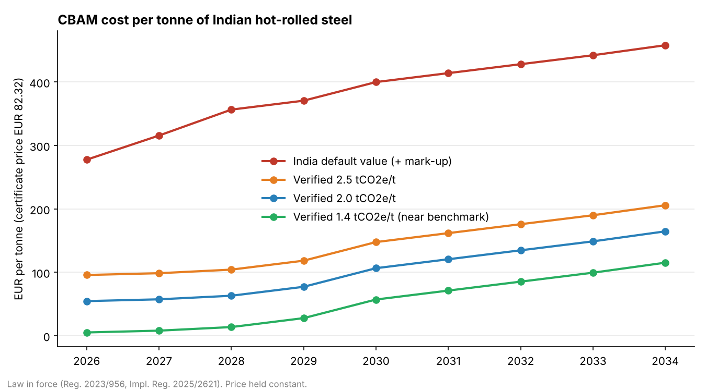
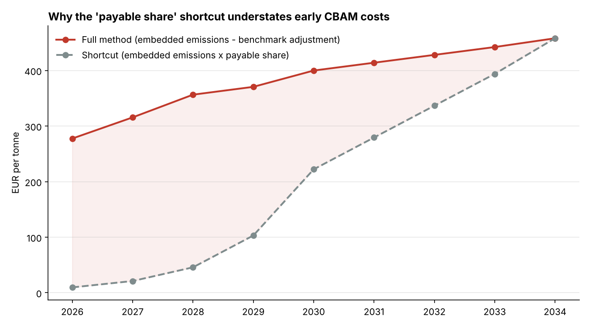
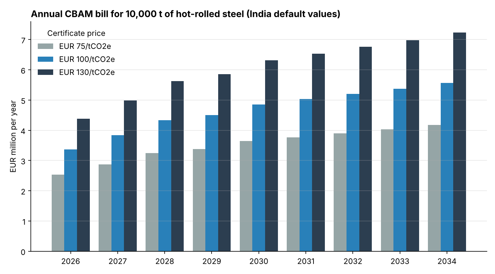

# CBAM Steel Cost Calculator 🇮🇳 → 🇪🇺

A Python tool that estimates what the **EU Carbon Border Adjustment Mechanism (CBAM)** will cost
Indian steel exporters (and their EU importers) from 2026 to 2034, when free allocation in the EU ETS
is fully phased out.

India is the EU's largest supplier of iron and steel. Since **1 January 2026** CBAM has been in its
definitive phase, so imports now create a real certificate obligation. This project turns the legal
formula into code you can run, test and use for scenario analysis.



## What it does

* **Applies the full legal method**, not a shortcut:
  `certificates = embedded emissions − (benchmark × CBAM factor × CSCF × tonnes) − origin carbon price deduction`
* **Uses India-specific default values** from Implementing Regulation (EU) 2025/2621, with the
  regulatory mark-up (+10 % in 2026, +20 % in 2027, +30 % from 2028).
* **Compares default vs. verified emissions**, which shows how much a mill saves by getting its
  installation data verified.
* Handles the **50-tonne de minimis exemption** and an optional **carbon price paid in India**
  (for example if India's Carbon Credit Trading Scheme were recognised under Article 9).
* Has a **command-line interface**, a small Python API, **charts**, and **unit tests** that check the
  results against a published worked example.

## Key finding: the "payable share" shortcut is misleading

Many articles say importers "pay 2.5 % of emissions in 2026". That is only true for a producer whose
emissions equal the EU benchmark. For hot-rolled steel declared on India's default values, the
free-allocation adjustment only removes about 1.34 tCO2e per tonne, so the importer pays for most of
the remaining ~3.4 tCO2e from day one.



| Year | Full method (EUR/t) | Shortcut (EUR/t) |
|---|---:|---:|
| 2026 | 277.60 | 9.69 |
| 2030 | 399.95 | 222.14 |
| 2034 | 458.03 | 458.03 |

*Hot-rolled flat steel (CN 7208), India default values, certificate price €82.32 (Q3 2026) held constant.*

## Quick start

```bash
git clone https://github.com/Tawuf/cbam-steel-calculator.git
cd cbam-steel-calculator
pip install -r requirements.txt

# Cost of 500 t of hot-rolled steel imported in 2026, on India default values
python -m cbam_calc estimate --tonnes 500 --year 2026

# Same line with verified emissions of 2.1 tCO2e/t
python -m cbam_calc estimate --tonnes 500 --year 2026 --intensity 2.1

# Year-by-year projection 2026-2034 (add --csv to export)
python -m cbam_calc projection --tonnes 10000 --price 100

# Full method vs. shortcut
python -m cbam_calc compare --tonnes 1000

# Regenerate the charts in docs/
python -m cbam_calc.charts
```

Example output:

```
Year                          2026
Intensity (default)           4.708 tCO2e/t
Embedded emissions            2,354.0 tCO2e
Free-allocation adjustment  - 667.9 tCO2e
CBAM certificates             1,686.1
Certificate price             EUR 82.32
Total cost                    EUR 138,802  (277.60 EUR per tonne)
```

### Python API

```python
from cbam_calc import estimate, projection, load_products

hrf = load_products()["hot_rolled_flat"]
e = estimate(500, 2027, product=hrf, verified_intensity=2.2, price=90)
print(e.certificates, e.cost_eur, e.cost_per_tonne)
```

## Price sensitivity



## Project structure

```
cbam_calc/
  policy.py       CBAM factor, mark-ups, de minimis, prices, product presets
  calculator.py   estimate(), projection(), break_even_intensity(), simplified_estimate()
  cli.py          command-line interface
  charts.py       README charts
data/
  india_steel_defaults.csv   India default values and benchmarks
  SOURCES.md                 where every number comes from
tests/            pytest suite (12 tests)
```

## Assumptions and limitations

* Only **direct** embedded emissions are priced, as for all Annex II goods such as iron and steel.
* The certificate price is held constant across years. Use `--price` to test scenarios.
* Benchmarks for pig iron and DRI are not included yet. Pass `--benchmark` for those products.
* The tool follows the **law in force**. The July 2026 Commission proposal COM(2026) 616, which
  would slow the phase-in to 2038, is not modelled yet. It is a natural next feature.
* This is an educational and analytical tool, not legal or customs advice.
  See [`data/SOURCES.md`](data/SOURCES.md).

## Running the tests

```bash
pytest -q
```

## Author

**Md Tawuf Chowdhury**: MSc Information Systems (Uppsala University), B.Sc. Environmental and
Resource Management (BTU Cottbus-Senftenberg). Built as part of my work on CBAM and India's steel exports.

License: MIT
